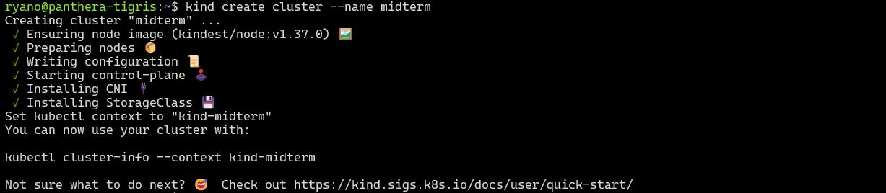
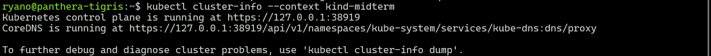
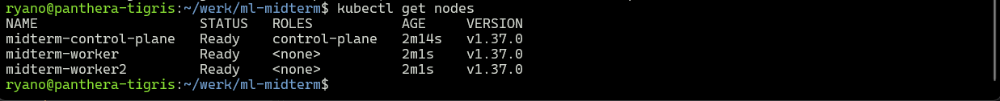
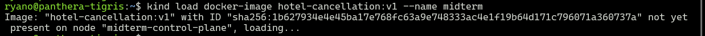
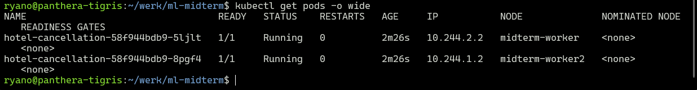
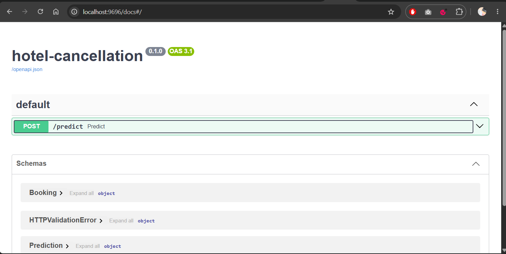
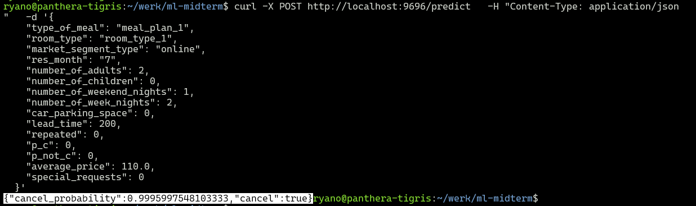
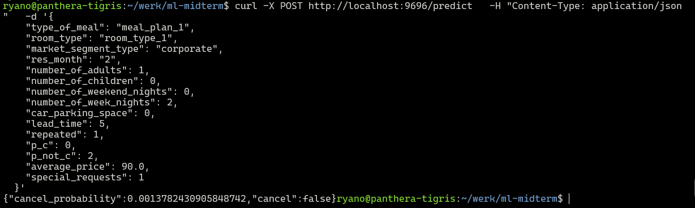

# Hotel Booking Cancellation Prediction

Midterm project for [ML Zoomcamp](https://github.com/DataTalksClub/machine-learning-zoomcamp).

## Problem description

Booking cancellations are a major source of lost revenue for hotels. A room that was
expected to be occupied ends up empty, often too late to be resold. If a hotel knows
**which bookings are likely to be cancelled**, it can act early, for example:

- send a reminder or ask for a deposit on high-risk bookings,
- offer the room to a waiting list,
- plan overbooking more carefully,
- forecast occupancy and revenue more realistically.

This project builds a **binary classifier** that predicts whether a booking will be
cancelled (`is_canceled = 1`) from information known at booking time (lead time, market
segment, price, number of guests, special requests, guest history, etc.).

The model is exposed as a web service. A hotel system sends the booking details as JSON
and receives the **cancellation probability** and a decision (threshold 0.5, adjustable
by the hotel depending on the cost of false positives vs. false negatives).

## Dataset

[Hotel Booking Cancellation Prediction (Kaggle)](https://www.kaggle.com/datasets/youssefaboelwafa/hotel-booking-cancellation-prediction)

- 36,285 bookings, 17 columns, no missing values
- Target: `booking status` (`Canceled` / `Not_Canceled`), about 32.8% cancelled
- Features: number of adults/children, weekend/week nights, meal plan, parking, room type,
  lead time, market segment, repeated guest, previous cancellations (`P-C`),
  previous non-cancelled bookings (`P-not-C`), average price, special requests,
  date of reservation

### Getting the data

The dataset is included in the repository as `data/booking.csv`. To download it again
from Kaggle:

```bash
mkdir -p data
curl -L -o data/hotel-booking-cancellation-prediction.zip \
  https://www.kaggle.com/api/v1/datasets/download/youssefaboelwafa/hotel-booking-cancellation-prediction
unzip -o data/hotel-booking-cancellation-prediction.zip -d data/
```

The file used by the notebook and `train.py` is `data/booking.csv`.

## Exploratory data analysis (summary)

All target-related analysis was done on the training portion only (80%); the test set
was kept untouched until the final evaluation.

- Global cancellation rate: 32.8%.
- `lead_time` is the strongest predictor and its relationship is non-linear:
  8.7% cancellation at ≤7 days up to 72.6% at 181–365 days (correlation with target 0.44).
- `special_requests` is negatively correlated with cancellation (-0.26).
- Guests with booking history (`p_c` or `p_not_c` > 0) almost never cancel (<5%).
- Market segment matters: online 36%, offline 30%, corporate 11%, complementary 0%.
- Month of reservation shows large variation, but the data covers roughly Oct 2017 to
  Sep 2018 and the monthly pattern moves together with average lead time, so seasonality
  cannot be confirmed.
- Two rows dated 2015/2016 look anomalous but were left in the data (negligible
  impact); the invalid date `2018-2-29` was corrected to `2018-02-28`.

## Modeling

Features: `type_of_meal`, `room_type`, `market_segment_type`, `res_month` and 11 numeric
columns. `res_dow` was dropped (no measurable gain), and `res_month` was kept because
removing it lowered validation AUC (0.950 → 0.940).

Three models were tuned with 5-fold cross-validation on the training data
(`df_full_train`); parameters were first explored on a single validation split and then
confirmed with K-Fold.

| Model               | Tuned parameters                                 | Selected                        | CV AUC (mean ± std) |
| ------------------- | ------------------------------------------------ | ------------------------------- | ------------------- |
| Logistic Regression | `C`                                              | `C=1`                           | 0.8706 ± 0.0035     |
| Random Forest       | `max_depth`, `min_samples_leaf`, `n_estimators`  | 20, 1, 100                      | 0.9505 ± 0.0015     |
| **XGBoost**         | `max_depth`, `learning_rate`, `min_child_weight` | 10, 0.2, 1 (`n_estimators=100`) | **0.9526 ± 0.0024** |

XGBoost and Random Forest are statistically close (difference smaller than the standard
deviation); XGBoost was chosen for the highest mean AUC and consistent results across
both evaluation methods. Logistic Regression is clearly worse, mainly because it cannot
capture the non-linear effect of `lead_time`.

### Threshold and final evaluation

The decision threshold was chosen from out-of-fold predictions on the training data
(precision/recall/F1 for thresholds 0.2-0.7). F1 is highest at 0.5 and nearly flat
between 0.4 and 0.5, so the default 0.5 is used. A lower threshold increases recall at
the cost of precision, and the right value depends on the hotel's cost of missed
cancellations vs. false alarms.

The test set was not used to choose the model, parameters, features or threshold. It was
only used to report the final performance:

| Metric    | Value (threshold 0.5) |
| --------- | --------------------- |
| ROC AUC   | 0.9548                |
| Precision | 0.866                 |
| Recall    | 0.802                 |
| F1        | 0.833                 |

### Limitations

- Random train/validation/test split; performance on a future period may be lower.
- Only about 15 months of data, so seasonal effects are not reliable.
- Tree models can output very extreme probabilities; the ranking of risk is more
  trustworthy than the exact probability value.

## Project structure

```
.
├── Dockerfile
├── README.md
├── data
│   └── booking.csv
├── docker-compose.yaml
├── k8s
│   ├── deployment.yaml
│   ├── kind-config.yaml
│   └── service.yaml
├── model.bin
├── notebook.ipynb
├── pics/
├── predict.py
├── pyproject.toml
├── train.py
└── uv.lock
```

## How to run

### 1. Environment

Dependencies are managed with [uv](https://docs.astral.sh/uv/). They are declared in
`pyproject.toml` and pinned in `uv.lock`. The project requires Python >= 3.14; uv
downloads a matching interpreter automatically if you don't have one.

Install uv (if needed):

```bash
curl -LsSf https://astral.sh/uv/install.sh | sh
```

Clone the repo, then create the virtual environment (`.venv`) and install the locked
dependencies:

```bash
git clone https://github.com/oillypump/ml-midterm.git
cd ml-midterm
uv sync
```

`uv sync` also installs the `dev` group (Jupyter kernel, matplotlib, seaborn, nbconvert)
needed for the notebook. To install only what the service needs:

```bash
uv sync --no-dev
```

Activate the environment, or skip activation and prefix commands with `uv run` (used
below):

```bash
source .venv/bin/activate        # Linux / macOS / WSL
# .venv\Scripts\activate         # Windows
```

To run the notebook, open `notebook.ipynb` in VS Code or JupyterLab and select the
`.venv` interpreter as the kernel.

### 2. Train the model

```bash
uv run python train.py
```

This runs 5-fold CV, trains the final model on the full training split, prints the test
AUC and saves `model.bin`. Expected: CV AUC ≈ 0.9526 and test AUC ≈ 0.9548.

### 3. Run the web service locally

```bash
uv run uvicorn predict:app --host 0.0.0.0 --port 9696
```

The service is built with FastAPI and listens on port 9696. It exposes `POST /predict`,
and interactive API docs are available at `http://localhost:9696/docs`.

### 4. Test the service

Send a request with `curl`, or use the interactive docs at `http://localhost:9696/docs`.

example data

```json
{
  "type_of_meal": "meal_plan_1",
  "room_type": "room_type_1",
  "market_segment_type": "online",
  "res_month": "7",
  "number_of_adults": 2,
  "number_of_children": 0,
  "number_of_weekend_nights": 1,
  "number_of_week_nights": 2,
  "car_parking_space": 0,
  "lead_time": 200,
  "repeated": 0,
  "p_c": 0,
  "p_not_c": 0,
  "average_price": 110.0,
  "special_requests": 0
}
```

Example test curl :

```
curl -X POST http://localhost:9696/predict \
  -H "Content-Type: application/json" \
  -d '{
    "type_of_meal": "meal_plan_1",
    "room_type": "room_type_1",
    "market_segment_type": "online",
    "res_month": "7",
    "number_of_adults": 2,
    "number_of_children": 0,
    "number_of_weekend_nights": 1,
    "number_of_week_nights": 2,
    "car_parking_space": 0,
    "lead_time": 200,
    "repeated": 0,
    "p_c": 0,
    "p_not_c": 0,
    "average_price": 110.0,
    "special_requests": 0
  }'
```

Categorical values must match the training data exactly (lowercase, e.g. `meal_plan_1`, `room_type_1`, `online`), and `res_month` is a string (`"1"`–`"12"`).

example response :

```
{"cancel_probability": 0.9996, "cancel": true}

```

### 5. Docker

The service is containerized with the provided `Dockerfile`, and `docker-compose.yaml`
wraps the build and run steps.

```bash
docker compose up -d --build
```

The service is then available at `http://localhost:9696/predict`.

```bash
docker ps
```

Wait until the container status changes from `starting` to `healthy`

Stop it with `docker compose down`.

Without Compose:

```bash
docker build -t hotel-cancellation .
docker run -it --rm -p 9696:9696 hotel-cancellation
```

### 6. Local Kubernetes Deployment (kind)

Prerequisites: Docker, [kind](https://kind.sigs.k8s.io/) and `kubectl`.
The Kubernetes manifests are in `k8s/`.

This is a local cluster, so there is no public URL; the screenshots below show the
deployment and the test requests.

`kind-config.yaml` maps port 9696 of the cluster to `localhost:9696` (NodePort service),
so no `port-forward` is needed. Stop `docker compose` first if it is running, otherwise
port 9696 is already in use.

```
kind create cluster --name midterm --config ./k8s/kind-config.yaml
```



```
kubectl cluster-info --context kind-midterm
```



```
kubectl get nodes
```



```
docker images | grep -E "hotel|midterm"
```


```
docker build -t hotel-cancellation:latest .
docker tag hotel-cancellation:latest hotel-cancellation:v1
```


```
kind load docker-image hotel-cancellation:v1 --name midterm
```



```
kubectl apply -f ./k8s/deployment.yaml -f ./k8s/service.yaml
```


```
kubectl get pods -o wide
```



- Testing
  - open docs :

    

  - test curl1:

    

  - test curl2:

    

- Cleanup

  ```
  kubectl delete -f ./k8s/deployment.yaml -f ./k8s/service.yaml
  kind delete cluster --name midterm
  ```
