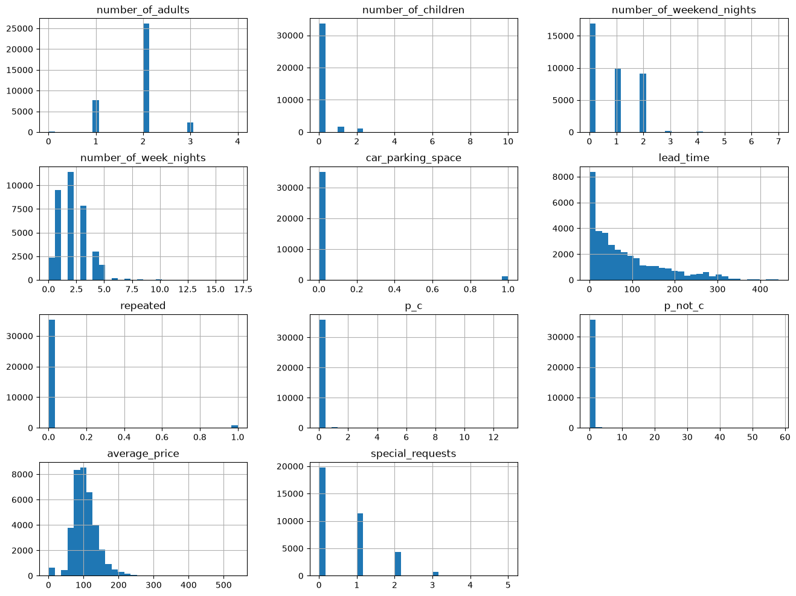

# mid-term project

https://www.kaggle.com/datasets/youssefaboelwafa/hotel-booking-cancellation-prediction

## data preparation


```python
import pandas as pd
import numpy as np
import matplotlib.pyplot as plt
import seaborn as sns

```


```python
# !curl -L -o data/hotel-booking-cancellation-prediction.zip https://www.kaggle.com/api/v1/datasets/download/youssefaboelwafa/hotel-booking-cancellation-prediction
# !unzip -o data/hotel-booking-cancellation-prediction.zip -d data/
df_orig = pd.read_csv('data/booking.csv')
```


```python
df = df_orig.copy()
```


```python
df.shape
```


    (36285, 17)


```python
df.info()
```

    <class 'pandas.DataFrame'>
    RangeIndex: 36285 entries, 0 to 36284
    Data columns (total 17 columns):
     #   Column                    Non-Null Count  Dtype  
    ---  ------                    --------------  -----  
     0   Booking_ID                36285 non-null  str    
     1   number of adults          36285 non-null  int64  
     2   number of children        36285 non-null  int64  
     3   number of weekend nights  36285 non-null  int64  
     4   number of week nights     36285 non-null  int64  
     5   type of meal              36285 non-null  str    
     6   car parking space         36285 non-null  int64  
     7   room type                 36285 non-null  str    
     8   lead time                 36285 non-null  int64  
     9   market segment type       36285 non-null  str    
     10  repeated                  36285 non-null  int64  
     11  P-C                       36285 non-null  int64  
     12  P-not-C                   36285 non-null  int64  
     13  average price             36285 non-null  float64
     14  special requests          36285 non-null  int64  
     15  date of reservation       36285 non-null  str    
     16  booking status            36285 non-null  str    
    dtypes: float64(1), int64(10), str(6)
    memory usage: 4.7 MB


```python
df.describe().round(3)
```


<div>
<style scoped>
    .dataframe tbody tr th:only-of-type {
        vertical-align: middle;
    }

    .dataframe tbody tr th {
        vertical-align: top;
    }

    .dataframe thead th {
        text-align: right;
    }
</style>
<table border="1" class="dataframe">
  <thead>
    <tr style="text-align: right;">
      <th></th>
      <th>number of adults</th>
      <th>number of children</th>
      <th>number of weekend nights</th>
      <th>number of week nights</th>
      <th>car parking space</th>
      <th>lead time</th>
      <th>repeated</th>
      <th>P-C</th>
      <th>P-not-C</th>
      <th>average price</th>
      <th>special requests</th>
    </tr>
  </thead>
  <tbody>
    <tr>
      <th>count</th>
      <td>36285.000</td>
      <td>36285.000</td>
      <td>36285.000</td>
      <td>36285.000</td>
      <td>36285.000</td>
      <td>36285.000</td>
      <td>36285.000</td>
      <td>36285.000</td>
      <td>36285.000</td>
      <td>36285.000</td>
      <td>36285.000</td>
    </tr>
    <tr>
      <th>mean</th>
      <td>1.845</td>
      <td>0.105</td>
      <td>0.811</td>
      <td>2.205</td>
      <td>0.031</td>
      <td>85.240</td>
      <td>0.026</td>
      <td>0.023</td>
      <td>0.153</td>
      <td>103.422</td>
      <td>0.620</td>
    </tr>
    <tr>
      <th>std</th>
      <td>0.519</td>
      <td>0.403</td>
      <td>0.871</td>
      <td>1.411</td>
      <td>0.173</td>
      <td>85.939</td>
      <td>0.158</td>
      <td>0.368</td>
      <td>1.754</td>
      <td>35.086</td>
      <td>0.786</td>
    </tr>
    <tr>
      <th>min</th>
      <td>0.000</td>
      <td>0.000</td>
      <td>0.000</td>
      <td>0.000</td>
      <td>0.000</td>
      <td>0.000</td>
      <td>0.000</td>
      <td>0.000</td>
      <td>0.000</td>
      <td>0.000</td>
      <td>0.000</td>
    </tr>
    <tr>
      <th>25%</th>
      <td>2.000</td>
      <td>0.000</td>
      <td>0.000</td>
      <td>1.000</td>
      <td>0.000</td>
      <td>17.000</td>
      <td>0.000</td>
      <td>0.000</td>
      <td>0.000</td>
      <td>80.300</td>
      <td>0.000</td>
    </tr>
    <tr>
      <th>50%</th>
      <td>2.000</td>
      <td>0.000</td>
      <td>1.000</td>
      <td>2.000</td>
      <td>0.000</td>
      <td>57.000</td>
      <td>0.000</td>
      <td>0.000</td>
      <td>0.000</td>
      <td>99.450</td>
      <td>0.000</td>
    </tr>
    <tr>
      <th>75%</th>
      <td>2.000</td>
      <td>0.000</td>
      <td>2.000</td>
      <td>3.000</td>
      <td>0.000</td>
      <td>126.000</td>
      <td>0.000</td>
      <td>0.000</td>
      <td>0.000</td>
      <td>120.000</td>
      <td>1.000</td>
    </tr>
    <tr>
      <th>max</th>
      <td>4.000</td>
      <td>10.000</td>
      <td>7.000</td>
      <td>17.000</td>
      <td>1.000</td>
      <td>443.000</td>
      <td>1.000</td>
      <td>13.000</td>
      <td>58.000</td>
      <td>540.000</td>
      <td>5.000</td>
    </tr>
  </tbody>
</table>
</div>


```python
df.head().T
```


<div>
<style scoped>
    .dataframe tbody tr th:only-of-type {
        vertical-align: middle;
    }

    .dataframe tbody tr th {
        vertical-align: top;
    }

    .dataframe thead th {
        text-align: right;
    }
</style>
<table border="1" class="dataframe">
  <thead>
    <tr style="text-align: right;">
      <th></th>
      <th>0</th>
      <th>1</th>
      <th>2</th>
      <th>3</th>
      <th>4</th>
    </tr>
  </thead>
  <tbody>
    <tr>
      <th>Booking_ID</th>
      <td>INN00001</td>
      <td>INN00002</td>
      <td>INN00003</td>
      <td>INN00004</td>
      <td>INN00005</td>
    </tr>
    <tr>
      <th>number of adults</th>
      <td>1</td>
      <td>1</td>
      <td>2</td>
      <td>1</td>
      <td>1</td>
    </tr>
    <tr>
      <th>number of children</th>
      <td>1</td>
      <td>0</td>
      <td>1</td>
      <td>0</td>
      <td>0</td>
    </tr>
    <tr>
      <th>number of weekend nights</th>
      <td>2</td>
      <td>1</td>
      <td>1</td>
      <td>0</td>
      <td>1</td>
    </tr>
    <tr>
      <th>number of week nights</th>
      <td>5</td>
      <td>3</td>
      <td>3</td>
      <td>2</td>
      <td>2</td>
    </tr>
    <tr>
      <th>type of meal</th>
      <td>Meal Plan 1</td>
      <td>Not Selected</td>
      <td>Meal Plan 1</td>
      <td>Meal Plan 1</td>
      <td>Not Selected</td>
    </tr>
    <tr>
      <th>car parking space</th>
      <td>0</td>
      <td>0</td>
      <td>0</td>
      <td>0</td>
      <td>0</td>
    </tr>
    <tr>
      <th>room type</th>
      <td>Room_Type 1</td>
      <td>Room_Type 1</td>
      <td>Room_Type 1</td>
      <td>Room_Type 1</td>
      <td>Room_Type 1</td>
    </tr>
    <tr>
      <th>lead time</th>
      <td>224</td>
      <td>5</td>
      <td>1</td>
      <td>211</td>
      <td>48</td>
    </tr>
    <tr>
      <th>market segment type</th>
      <td>Offline</td>
      <td>Online</td>
      <td>Online</td>
      <td>Online</td>
      <td>Online</td>
    </tr>
    <tr>
      <th>repeated</th>
      <td>0</td>
      <td>0</td>
      <td>0</td>
      <td>0</td>
      <td>0</td>
    </tr>
    <tr>
      <th>P-C</th>
      <td>0</td>
      <td>0</td>
      <td>0</td>
      <td>0</td>
      <td>0</td>
    </tr>
    <tr>
      <th>P-not-C</th>
      <td>0</td>
      <td>0</td>
      <td>0</td>
      <td>0</td>
      <td>0</td>
    </tr>
    <tr>
      <th>average price</th>
      <td>88.0</td>
      <td>106.68</td>
      <td>50.0</td>
      <td>100.0</td>
      <td>77.0</td>
    </tr>
    <tr>
      <th>special requests</th>
      <td>0</td>
      <td>1</td>
      <td>0</td>
      <td>1</td>
      <td>0</td>
    </tr>
    <tr>
      <th>date of reservation</th>
      <td>10/2/2015</td>
      <td>11/6/2018</td>
      <td>2/28/2018</td>
      <td>5/20/2017</td>
      <td>4/11/2018</td>
    </tr>
    <tr>
      <th>booking status</th>
      <td>Not_Canceled</td>
      <td>Not_Canceled</td>
      <td>Canceled</td>
      <td>Canceled</td>
      <td>Canceled</td>
    </tr>
  </tbody>
</table>
</div>


### EDA


```python
df.isnull().sum().sort_values(ascending=False)
```


    Booking_ID                  0
    number of adults            0
    number of children          0
    number of weekend nights    0
    number of week nights       0
    type of meal                0
    car parking space           0
    room type                   0
    lead time                   0
    market segment type         0
    repeated                    0
    P-C                         0
    P-not-C                     0
    average price               0
    special requests            0
    date of reservation         0
    booking status              0
    dtype: int64


```python
df.columns = df.columns.str.lower().str.replace(' ', '_').str.replace('-', '_')

categorical_columns = df.select_dtypes(include=['object', 'category', 'str']).columns.tolist()

for c in categorical_columns:
    df[c] = df[c].str.lower().str.replace(' ', '_')

df['is_canceled'] = (df.booking_status == 'canceled').astype(int)
df = df.drop(columns="booking_status")
```


```python
df.head().T
```


<div>
<style scoped>
    .dataframe tbody tr th:only-of-type {
        vertical-align: middle;
    }

    .dataframe tbody tr th {
        vertical-align: top;
    }

    .dataframe thead th {
        text-align: right;
    }
</style>
<table border="1" class="dataframe">
  <thead>
    <tr style="text-align: right;">
      <th></th>
      <th>0</th>
      <th>1</th>
      <th>2</th>
      <th>3</th>
      <th>4</th>
    </tr>
  </thead>
  <tbody>
    <tr>
      <th>booking_id</th>
      <td>inn00001</td>
      <td>inn00002</td>
      <td>inn00003</td>
      <td>inn00004</td>
      <td>inn00005</td>
    </tr>
    <tr>
      <th>number_of_adults</th>
      <td>1</td>
      <td>1</td>
      <td>2</td>
      <td>1</td>
      <td>1</td>
    </tr>
    <tr>
      <th>number_of_children</th>
      <td>1</td>
      <td>0</td>
      <td>1</td>
      <td>0</td>
      <td>0</td>
    </tr>
    <tr>
      <th>number_of_weekend_nights</th>
      <td>2</td>
      <td>1</td>
      <td>1</td>
      <td>0</td>
      <td>1</td>
    </tr>
    <tr>
      <th>number_of_week_nights</th>
      <td>5</td>
      <td>3</td>
      <td>3</td>
      <td>2</td>
      <td>2</td>
    </tr>
    <tr>
      <th>type_of_meal</th>
      <td>meal_plan_1</td>
      <td>not_selected</td>
      <td>meal_plan_1</td>
      <td>meal_plan_1</td>
      <td>not_selected</td>
    </tr>
    <tr>
      <th>car_parking_space</th>
      <td>0</td>
      <td>0</td>
      <td>0</td>
      <td>0</td>
      <td>0</td>
    </tr>
    <tr>
      <th>room_type</th>
      <td>room_type_1</td>
      <td>room_type_1</td>
      <td>room_type_1</td>
      <td>room_type_1</td>
      <td>room_type_1</td>
    </tr>
    <tr>
      <th>lead_time</th>
      <td>224</td>
      <td>5</td>
      <td>1</td>
      <td>211</td>
      <td>48</td>
    </tr>
    <tr>
      <th>market_segment_type</th>
      <td>offline</td>
      <td>online</td>
      <td>online</td>
      <td>online</td>
      <td>online</td>
    </tr>
    <tr>
      <th>repeated</th>
      <td>0</td>
      <td>0</td>
      <td>0</td>
      <td>0</td>
      <td>0</td>
    </tr>
    <tr>
      <th>p_c</th>
      <td>0</td>
      <td>0</td>
      <td>0</td>
      <td>0</td>
      <td>0</td>
    </tr>
    <tr>
      <th>p_not_c</th>
      <td>0</td>
      <td>0</td>
      <td>0</td>
      <td>0</td>
      <td>0</td>
    </tr>
    <tr>
      <th>average_price</th>
      <td>88.0</td>
      <td>106.68</td>
      <td>50.0</td>
      <td>100.0</td>
      <td>77.0</td>
    </tr>
    <tr>
      <th>special_requests</th>
      <td>0</td>
      <td>1</td>
      <td>0</td>
      <td>1</td>
      <td>0</td>
    </tr>
    <tr>
      <th>date_of_reservation</th>
      <td>10/2/2015</td>
      <td>11/6/2018</td>
      <td>2/28/2018</td>
      <td>5/20/2017</td>
      <td>4/11/2018</td>
    </tr>
    <tr>
      <th>is_canceled</th>
      <td>0</td>
      <td>0</td>
      <td>1</td>
      <td>1</td>
      <td>1</td>
    </tr>
  </tbody>
</table>
</div>


check invalid date_of_reservation,
and replace 2018-2-29 with 2018-02-28


```python
temp_dates = pd.to_datetime(df['date_of_reservation'], errors='coerce')
invalid_rows = df[temp_dates.isna()]

print(f"length invalid rows : {len(invalid_rows)}")
max_date = invalid_rows['date_of_reservation'].max()
min_date = invalid_rows['date_of_reservation'].min()
print(f'range date_of_reservation : {min_date} to {max_date}')

df.loc[df['date_of_reservation'] == '2018-2-29', 'date_of_reservation'] = '2/28/2018'
```

    length invalid rows : 37
    range date_of_reservation : 2018-2-29 to 2018-2-29


```python
df['date_of_reservation'] = pd.to_datetime(df['date_of_reservation'])
df['res_month'] = df['date_of_reservation'].dt.month.astype('str')
df['res_dow'] = df['date_of_reservation'].dt.day_of_week.astype('str')
```

check 0 guests,


```python
ghost_bookings = df[(df['number_of_adults'] == 0) & (df['number_of_children'] == 0)]
ghost_bookings.value_counts().sum()
```


    np.int64(0)


check 0 average price per room,


```python
zero_price_bookings = df[df.average_price == 0]
zero_price_bookings.value_counts().sum()

segment_counts = zero_price_bookings['market_segment_type'].value_counts()
print("0 average price bookings by market segment type:")
print(segment_counts)
```

    0 average price bookings by market segment type:
    market_segment_type
    complementary    354
    online           191
    Name: count, dtype: int64


```python
# plt.figure(figsize=(5, 5))
# sns.barplot(x=segment_counts.index, y=segment_counts.values)
# plt.title('free room based on market_segment_type')
# plt.xlabel('Market Segment Type')
# plt.ylabel('count rows')
# plt.grid(axis='y', linestyle='--', alpha=0.7)
# plt.show()
```


```python
df['total_guests'] = df['number_of_adults'] + df['number_of_children']
df['total_nights'] = df['number_of_weekend_nights'] + df['number_of_week_nights']
```


```python
df.head().T
```


<div>
<style scoped>
    .dataframe tbody tr th:only-of-type {
        vertical-align: middle;
    }

    .dataframe tbody tr th {
        vertical-align: top;
    }

    .dataframe thead th {
        text-align: right;
    }
</style>
<table border="1" class="dataframe">
  <thead>
    <tr style="text-align: right;">
      <th></th>
      <th>0</th>
      <th>1</th>
      <th>2</th>
      <th>3</th>
      <th>4</th>
    </tr>
  </thead>
  <tbody>
    <tr>
      <th>booking_id</th>
      <td>inn00001</td>
      <td>inn00002</td>
      <td>inn00003</td>
      <td>inn00004</td>
      <td>inn00005</td>
    </tr>
    <tr>
      <th>number_of_adults</th>
      <td>1</td>
      <td>1</td>
      <td>2</td>
      <td>1</td>
      <td>1</td>
    </tr>
    <tr>
      <th>number_of_children</th>
      <td>1</td>
      <td>0</td>
      <td>1</td>
      <td>0</td>
      <td>0</td>
    </tr>
    <tr>
      <th>number_of_weekend_nights</th>
      <td>2</td>
      <td>1</td>
      <td>1</td>
      <td>0</td>
      <td>1</td>
    </tr>
    <tr>
      <th>number_of_week_nights</th>
      <td>5</td>
      <td>3</td>
      <td>3</td>
      <td>2</td>
      <td>2</td>
    </tr>
    <tr>
      <th>type_of_meal</th>
      <td>meal_plan_1</td>
      <td>not_selected</td>
      <td>meal_plan_1</td>
      <td>meal_plan_1</td>
      <td>not_selected</td>
    </tr>
    <tr>
      <th>car_parking_space</th>
      <td>0</td>
      <td>0</td>
      <td>0</td>
      <td>0</td>
      <td>0</td>
    </tr>
    <tr>
      <th>room_type</th>
      <td>room_type_1</td>
      <td>room_type_1</td>
      <td>room_type_1</td>
      <td>room_type_1</td>
      <td>room_type_1</td>
    </tr>
    <tr>
      <th>lead_time</th>
      <td>224</td>
      <td>5</td>
      <td>1</td>
      <td>211</td>
      <td>48</td>
    </tr>
    <tr>
      <th>market_segment_type</th>
      <td>offline</td>
      <td>online</td>
      <td>online</td>
      <td>online</td>
      <td>online</td>
    </tr>
    <tr>
      <th>repeated</th>
      <td>0</td>
      <td>0</td>
      <td>0</td>
      <td>0</td>
      <td>0</td>
    </tr>
    <tr>
      <th>p_c</th>
      <td>0</td>
      <td>0</td>
      <td>0</td>
      <td>0</td>
      <td>0</td>
    </tr>
    <tr>
      <th>p_not_c</th>
      <td>0</td>
      <td>0</td>
      <td>0</td>
      <td>0</td>
      <td>0</td>
    </tr>
    <tr>
      <th>average_price</th>
      <td>88.0</td>
      <td>106.68</td>
      <td>50.0</td>
      <td>100.0</td>
      <td>77.0</td>
    </tr>
    <tr>
      <th>special_requests</th>
      <td>0</td>
      <td>1</td>
      <td>0</td>
      <td>1</td>
      <td>0</td>
    </tr>
    <tr>
      <th>date_of_reservation</th>
      <td>2015-10-02 00:00:00</td>
      <td>2018-11-06 00:00:00</td>
      <td>2018-02-28 00:00:00</td>
      <td>2017-05-20 00:00:00</td>
      <td>2018-04-11 00:00:00</td>
    </tr>
    <tr>
      <th>is_canceled</th>
      <td>0</td>
      <td>0</td>
      <td>1</td>
      <td>1</td>
      <td>1</td>
    </tr>
    <tr>
      <th>res_month</th>
      <td>10</td>
      <td>11</td>
      <td>2</td>
      <td>5</td>
      <td>4</td>
    </tr>
    <tr>
      <th>res_dow</th>
      <td>4</td>
      <td>1</td>
      <td>2</td>
      <td>5</td>
      <td>2</td>
    </tr>
    <tr>
      <th>total_guests</th>
      <td>2</td>
      <td>1</td>
      <td>3</td>
      <td>1</td>
      <td>1</td>
    </tr>
    <tr>
      <th>total_nights</th>
      <td>7</td>
      <td>4</td>
      <td>4</td>
      <td>2</td>
      <td>3</td>
    </tr>
  </tbody>
</table>
</div>


```python
df.describe().T.round(2)
```


<div>
<style scoped>
    .dataframe tbody tr th:only-of-type {
        vertical-align: middle;
    }

    .dataframe tbody tr th {
        vertical-align: top;
    }

    .dataframe thead th {
        text-align: right;
    }
</style>
<table border="1" class="dataframe">
  <thead>
    <tr style="text-align: right;">
      <th></th>
      <th>count</th>
      <th>mean</th>
      <th>min</th>
      <th>25%</th>
      <th>50%</th>
      <th>75%</th>
      <th>max</th>
      <th>std</th>
    </tr>
  </thead>
  <tbody>
    <tr>
      <th>number_of_adults</th>
      <td>36285.0</td>
      <td>1.844839</td>
      <td>0.0</td>
      <td>2.0</td>
      <td>2.0</td>
      <td>2.0</td>
      <td>4.0</td>
      <td>0.518813</td>
    </tr>
    <tr>
      <th>number_of_children</th>
      <td>36285.0</td>
      <td>0.10536</td>
      <td>0.0</td>
      <td>0.0</td>
      <td>0.0</td>
      <td>0.0</td>
      <td>10.0</td>
      <td>0.402704</td>
    </tr>
    <tr>
      <th>number_of_weekend_nights</th>
      <td>36285.0</td>
      <td>0.810693</td>
      <td>0.0</td>
      <td>0.0</td>
      <td>1.0</td>
      <td>2.0</td>
      <td>7.0</td>
      <td>0.87059</td>
    </tr>
    <tr>
      <th>number_of_week_nights</th>
      <td>36285.0</td>
      <td>2.204602</td>
      <td>0.0</td>
      <td>1.0</td>
      <td>2.0</td>
      <td>3.0</td>
      <td>17.0</td>
      <td>1.410946</td>
    </tr>
    <tr>
      <th>car_parking_space</th>
      <td>36285.0</td>
      <td>0.030977</td>
      <td>0.0</td>
      <td>0.0</td>
      <td>0.0</td>
      <td>0.0</td>
      <td>1.0</td>
      <td>0.173258</td>
    </tr>
    <tr>
      <th>lead_time</th>
      <td>36285.0</td>
      <td>85.239851</td>
      <td>0.0</td>
      <td>17.0</td>
      <td>57.0</td>
      <td>126.0</td>
      <td>443.0</td>
      <td>85.938796</td>
    </tr>
    <tr>
      <th>repeated</th>
      <td>36285.0</td>
      <td>0.02563</td>
      <td>0.0</td>
      <td>0.0</td>
      <td>0.0</td>
      <td>0.0</td>
      <td>1.0</td>
      <td>0.158032</td>
    </tr>
    <tr>
      <th>p_c</th>
      <td>36285.0</td>
      <td>0.023343</td>
      <td>0.0</td>
      <td>0.0</td>
      <td>0.0</td>
      <td>0.0</td>
      <td>13.0</td>
      <td>0.368281</td>
    </tr>
    <tr>
      <th>p_not_c</th>
      <td>36285.0</td>
      <td>0.153369</td>
      <td>0.0</td>
      <td>0.0</td>
      <td>0.0</td>
      <td>0.0</td>
      <td>58.0</td>
      <td>1.753931</td>
    </tr>
    <tr>
      <th>average_price</th>
      <td>36285.0</td>
      <td>103.421636</td>
      <td>0.0</td>
      <td>80.3</td>
      <td>99.45</td>
      <td>120.0</td>
      <td>540.0</td>
      <td>35.086469</td>
    </tr>
    <tr>
      <th>special_requests</th>
      <td>36285.0</td>
      <td>0.619733</td>
      <td>0.0</td>
      <td>0.0</td>
      <td>0.0</td>
      <td>1.0</td>
      <td>5.0</td>
      <td>0.786262</td>
    </tr>
    <tr>
      <th>date_of_reservation</th>
      <td>36285</td>
      <td>2018-05-24 13:22:45.886730</td>
      <td>2015-10-02 00:00:00</td>
      <td>2018-02-28 00:00:00</td>
      <td>2018-06-12 00:00:00</td>
      <td>2018-09-19 00:00:00</td>
      <td>2018-12-31 00:00:00</td>
      <td>NaN</td>
    </tr>
    <tr>
      <th>is_canceled</th>
      <td>36285.0</td>
      <td>0.327656</td>
      <td>0.0</td>
      <td>0.0</td>
      <td>0.0</td>
      <td>1.0</td>
      <td>1.0</td>
      <td>0.469365</td>
    </tr>
    <tr>
      <th>total_guests</th>
      <td>36285.0</td>
      <td>1.9502</td>
      <td>1.0</td>
      <td>2.0</td>
      <td>2.0</td>
      <td>2.0</td>
      <td>12.0</td>
      <td>0.650361</td>
    </tr>
    <tr>
      <th>total_nights</th>
      <td>36285.0</td>
      <td>3.015296</td>
      <td>0.0</td>
      <td>2.0</td>
      <td>3.0</td>
      <td>4.0</td>
      <td>24.0</td>
      <td>1.786</td>
    </tr>
  </tbody>
</table>
</div>


```python
cat_cols = ['type_of_meal', 'room_type', 'market_segment_type', 'res_month', 'res_dow']
num_cols = ['number_of_adults', 'number_of_children', 'number_of_weekend_nights',
            'number_of_week_nights', 'car_parking_space', 'lead_time', 'repeated',
            'p_c', 'p_not_c', 'average_price', 'special_requests']

```


```python

# Distribusi tiap fitur numerik
df[num_cols].hist(bins=30, figsize=(16, 12))

# Outlier
sns.boxplot(x=df['lead_time'])
sns.boxplot(x=df['average_price'])

# Distribusi kategori
sns.countplot(x='market_segment_type', data=df)

# Jumlah reservasi per bulan / hari
sns.countplot(x='res_month', data=df)

# Cek nilai janggal (harga 0, adults 0)
(df['average_price'] == 0).sum()
```


    np.int64(545)


    

    


==============================================================================


```python
from sklearn.model_selection import train_test_split
from sklearn.feature_extraction import DictVectorizer
from sklearn.metrics import roc_auc_score
```


```python
df_full_train, df_test = train_test_split(df, test_size=0.2, random_state=1, stratify=df['is_canceled'])
df_train, df_val = train_test_split(df_full_train, test_size=0.25, random_state=1, stratify=df_full_train['is_canceled'])
```


```python
len(df_train), len(df_val), len(df_test), len(df_full_train)
```


    (21771, 7257, 7257, 29028)


```python
df_train = df_train.reset_index(drop=True)
df_val = df_val.reset_index(drop=True)
df_test = df_test.reset_index(drop=True)
```


```python
y_train = df_train.is_canceled.values
y_val = df_val.is_canceled.values
y_test = df_test.is_canceled.values
```


```python
del df_train['is_canceled']
del df_val['is_canceled']
del df_test['is_canceled']
```


```python
print(len(y_train), len(y_val), len(y_test))

for name, y in [('train', y_train), ('val', y_val), ('test', y_test)]:
    print(name, y.mean().round(3))
```

    21771 7257 7257
    train 0.328
    val 0.328
    test 0.328


```python
# 1. Distribusi target
global_cancelation_rate = df_full_train.is_canceled.mean()
global_cancelation_rate.round(3)
```


    np.float64(0.328)


```python
from IPython.display import display
```


```python
for c in cat_cols :    
    # print(c)
    print(f"{c}   |   global cancelation = {global_cancelation_rate:.4f}")
    df_group = df_full_train.groupby(c).is_canceled.agg(['mean', 'count'])
    df_group['diff'] = df_group['mean'] - global_cancelation_rate
    df_group['risk'] = df_group['mean'] / global_cancelation_rate
    display(df_group.sort_values('risk', ascending=False))
    # display(df_group)
    df_group
    print()
    print()
```

    type_of_meal   |   global cancelation = 0.3276


<div>
<style scoped>
    .dataframe tbody tr th:only-of-type {
        vertical-align: middle;
    }

    .dataframe tbody tr th {
        vertical-align: top;
    }

    .dataframe thead th {
        text-align: right;
    }
</style>
<table border="1" class="dataframe">
  <thead>
    <tr style="text-align: right;">
      <th></th>
      <th>mean</th>
      <th>count</th>
      <th>diff</th>
      <th>risk</th>
    </tr>
    <tr>
      <th>type_of_meal</th>
      <th></th>
      <th></th>
      <th></th>
      <th></th>
    </tr>
  </thead>
  <tbody>
    <tr>
      <th>meal_plan_2</th>
      <td>0.458365</td>
      <td>2642</td>
      <td>0.130716</td>
      <td>1.398950</td>
    </tr>
    <tr>
      <th>meal_plan_3</th>
      <td>0.333333</td>
      <td>3</td>
      <td>0.005684</td>
      <td>1.017348</td>
    </tr>
    <tr>
      <th>not_selected</th>
      <td>0.331470</td>
      <td>4115</td>
      <td>0.003821</td>
      <td>1.011662</td>
    </tr>
    <tr>
      <th>meal_plan_1</th>
      <td>0.311433</td>
      <td>22268</td>
      <td>-0.016216</td>
      <td>0.950509</td>
    </tr>
  </tbody>
</table>
</div>


    
    
    room_type   |   global cancelation = 0.3276


<div>
<style scoped>
    .dataframe tbody tr th:only-of-type {
        vertical-align: middle;
    }

    .dataframe tbody tr th {
        vertical-align: top;
    }

    .dataframe thead th {
        text-align: right;
    }
</style>
<table border="1" class="dataframe">
  <thead>
    <tr style="text-align: right;">
      <th></th>
      <th>mean</th>
      <th>count</th>
      <th>diff</th>
      <th>risk</th>
    </tr>
    <tr>
      <th>room_type</th>
      <th></th>
      <th></th>
      <th></th>
      <th></th>
    </tr>
  </thead>
  <tbody>
    <tr>
      <th>room_type_6</th>
      <td>0.412533</td>
      <td>766</td>
      <td>0.084883</td>
      <td>1.259068</td>
    </tr>
    <tr>
      <th>room_type_3</th>
      <td>0.400000</td>
      <td>5</td>
      <td>0.072351</td>
      <td>1.220818</td>
    </tr>
    <tr>
      <th>room_type_2</th>
      <td>0.343693</td>
      <td>547</td>
      <td>0.016044</td>
      <td>1.048966</td>
    </tr>
    <tr>
      <th>room_type_4</th>
      <td>0.337364</td>
      <td>4879</td>
      <td>0.009715</td>
      <td>1.029651</td>
    </tr>
    <tr>
      <th>room_type_1</th>
      <td>0.323315</td>
      <td>22492</td>
      <td>-0.004334</td>
      <td>0.986772</td>
    </tr>
    <tr>
      <th>room_type_5</th>
      <td>0.268519</td>
      <td>216</td>
      <td>-0.059131</td>
      <td>0.819531</td>
    </tr>
    <tr>
      <th>room_type_7</th>
      <td>0.235772</td>
      <td>123</td>
      <td>-0.091877</td>
      <td>0.719588</td>
    </tr>
  </tbody>
</table>
</div>


    
    
    market_segment_type   |   global cancelation = 0.3276


<div>
<style scoped>
    .dataframe tbody tr th:only-of-type {
        vertical-align: middle;
    }

    .dataframe tbody tr th {
        vertical-align: top;
    }

    .dataframe thead th {
        text-align: right;
    }
</style>
<table border="1" class="dataframe">
  <thead>
    <tr style="text-align: right;">
      <th></th>
      <th>mean</th>
      <th>count</th>
      <th>diff</th>
      <th>risk</th>
    </tr>
    <tr>
      <th>market_segment_type</th>
      <th></th>
      <th></th>
      <th></th>
      <th></th>
    </tr>
  </thead>
  <tbody>
    <tr>
      <th>online</th>
      <td>0.363426</td>
      <td>18609</td>
      <td>0.035777</td>
      <td>1.109193</td>
    </tr>
    <tr>
      <th>offline</th>
      <td>0.302929</td>
      <td>8398</td>
      <td>-0.024720</td>
      <td>0.924554</td>
    </tr>
    <tr>
      <th>aviation</th>
      <td>0.280000</td>
      <td>100</td>
      <td>-0.047649</td>
      <td>0.854573</td>
    </tr>
    <tr>
      <th>corporate</th>
      <td>0.109657</td>
      <td>1605</td>
      <td>-0.217992</td>
      <td>0.334679</td>
    </tr>
    <tr>
      <th>complementary</th>
      <td>0.000000</td>
      <td>316</td>
      <td>-0.327649</td>
      <td>0.000000</td>
    </tr>
  </tbody>
</table>
</div>


    
    
    res_month   |   global cancelation = 0.3276


<div>
<style scoped>
    .dataframe tbody tr th:only-of-type {
        vertical-align: middle;
    }

    .dataframe tbody tr th {
        vertical-align: top;
    }

    .dataframe thead th {
        text-align: right;
    }
</style>
<table border="1" class="dataframe">
  <thead>
    <tr style="text-align: right;">
      <th></th>
      <th>mean</th>
      <th>count</th>
      <th>diff</th>
      <th>risk</th>
    </tr>
    <tr>
      <th>res_month</th>
      <th></th>
      <th></th>
      <th></th>
      <th></th>
    </tr>
  </thead>
  <tbody>
    <tr>
      <th>7</th>
      <td>0.454390</td>
      <td>2346</td>
      <td>0.126741</td>
      <td>1.386820</td>
    </tr>
    <tr>
      <th>6</th>
      <td>0.406986</td>
      <td>2548</td>
      <td>0.079337</td>
      <td>1.242139</td>
    </tr>
    <tr>
      <th>8</th>
      <td>0.378625</td>
      <td>3069</td>
      <td>0.050976</td>
      <td>1.155580</td>
    </tr>
    <tr>
      <th>4</th>
      <td>0.367774</td>
      <td>2197</td>
      <td>0.040125</td>
      <td>1.122464</td>
    </tr>
    <tr>
      <th>5</th>
      <td>0.361381</td>
      <td>2056</td>
      <td>0.033732</td>
      <td>1.102952</td>
    </tr>
    <tr>
      <th>10</th>
      <td>0.358116</td>
      <td>4183</td>
      <td>0.030467</td>
      <td>1.092987</td>
    </tr>
    <tr>
      <th>9</th>
      <td>0.330470</td>
      <td>3725</td>
      <td>0.002821</td>
      <td>1.008609</td>
    </tr>
    <tr>
      <th>3</th>
      <td>0.295039</td>
      <td>1915</td>
      <td>-0.032610</td>
      <td>0.900473</td>
    </tr>
    <tr>
      <th>11</th>
      <td>0.291876</td>
      <td>2388</td>
      <td>-0.035773</td>
      <td>0.890819</td>
    </tr>
    <tr>
      <th>2</th>
      <td>0.262283</td>
      <td>1384</td>
      <td>-0.065366</td>
      <td>0.800500</td>
    </tr>
    <tr>
      <th>12</th>
      <td>0.133832</td>
      <td>2406</td>
      <td>-0.193817</td>
      <td>0.408462</td>
    </tr>
    <tr>
      <th>1</th>
      <td>0.023428</td>
      <td>811</td>
      <td>-0.304221</td>
      <td>0.071503</td>
    </tr>
  </tbody>
</table>
</div>


    
    
    res_dow   |   global cancelation = 0.3276


<div>
<style scoped>
    .dataframe tbody tr th:only-of-type {
        vertical-align: middle;
    }

    .dataframe tbody tr th {
        vertical-align: top;
    }

    .dataframe thead th {
        text-align: right;
    }
</style>
<table border="1" class="dataframe">
  <thead>
    <tr style="text-align: right;">
      <th></th>
      <th>mean</th>
      <th>count</th>
      <th>diff</th>
      <th>risk</th>
    </tr>
    <tr>
      <th>res_dow</th>
      <th></th>
      <th></th>
      <th></th>
      <th></th>
    </tr>
  </thead>
  <tbody>
    <tr>
      <th>6</th>
      <td>0.374194</td>
      <td>4960</td>
      <td>0.046544</td>
      <td>1.142056</td>
    </tr>
    <tr>
      <th>2</th>
      <td>0.327388</td>
      <td>4093</td>
      <td>-0.000261</td>
      <td>0.999204</td>
    </tr>
    <tr>
      <th>1</th>
      <td>0.324539</td>
      <td>3904</td>
      <td>-0.003110</td>
      <td>0.990507</td>
    </tr>
    <tr>
      <th>5</th>
      <td>0.322647</td>
      <td>4367</td>
      <td>-0.005002</td>
      <td>0.984734</td>
    </tr>
    <tr>
      <th>4</th>
      <td>0.312582</td>
      <td>3791</td>
      <td>-0.015067</td>
      <td>0.954016</td>
    </tr>
    <tr>
      <th>3</th>
      <td>0.311475</td>
      <td>3599</td>
      <td>-0.016174</td>
      <td>0.950637</td>
    </tr>
    <tr>
      <th>0</th>
      <td>0.308994</td>
      <td>4314</td>
      <td>-0.018655</td>
      <td>0.943064</td>
    </tr>
  </tbody>
</table>
</div>


    
    


```python
# numerical correlation with target
df_full_train[num_cols].corrwith(df_full_train.is_canceled).sort_values(ascending=False)
```


    lead_time                   0.439481
    average_price               0.137427
    number_of_week_nights       0.090510
    number_of_adults            0.087355
    number_of_weekend_nights    0.065825
    number_of_children          0.030217
    p_c                        -0.031653
    p_not_c                    -0.060286
    car_parking_space          -0.088882
    repeated                   -0.107073
    special_requests           -0.257494
    dtype: float64


```python
# numerical correlation with target
df_full_train.groupby('is_canceled')[num_cols].mean().T
```


<div>
<style scoped>
    .dataframe tbody tr th:only-of-type {
        vertical-align: middle;
    }

    .dataframe tbody tr th {
        vertical-align: top;
    }

    .dataframe thead th {
        text-align: right;
    }
</style>
<table border="1" class="dataframe">
  <thead>
    <tr style="text-align: right;">
      <th>is_canceled</th>
      <th>0</th>
      <th>1</th>
    </tr>
  </thead>
  <tbody>
    <tr>
      <th>number_of_adults</th>
      <td>1.812061</td>
      <td>1.908422</td>
    </tr>
    <tr>
      <th>number_of_children</th>
      <td>0.096480</td>
      <td>0.122490</td>
    </tr>
    <tr>
      <th>number_of_weekend_nights</th>
      <td>0.770969</td>
      <td>0.893176</td>
    </tr>
    <tr>
      <th>number_of_week_nights</th>
      <td>2.116719</td>
      <td>2.389128</td>
    </tr>
    <tr>
      <th>car_parking_space</th>
      <td>0.042322</td>
      <td>0.009252</td>
    </tr>
    <tr>
      <th>lead_time</th>
      <td>58.936978</td>
      <td>139.465356</td>
    </tr>
    <tr>
      <th>repeated</th>
      <td>0.037147</td>
      <td>0.001262</td>
    </tr>
    <tr>
      <th>p_c</th>
      <td>0.031306</td>
      <td>0.006519</td>
    </tr>
    <tr>
      <th>p_not_c</th>
      <td>0.220987</td>
      <td>0.001682</td>
    </tr>
    <tr>
      <th>average_price</th>
      <td>100.003310</td>
      <td>110.276787</td>
    </tr>
    <tr>
      <th>special_requests</th>
      <td>0.761746</td>
      <td>0.330039</td>
    </tr>
  </tbody>
</table>
</div>


```python
# mutual information
from sklearn.metrics import mutual_info_score

def mutual_info_cancelation_score(series):
    return mutual_info_score(series, df_full_train.is_canceled)

mi = df_full_train[cat_cols].apply(mutual_info_cancelation_score)
mi.sort_values(ascending=False)
```


    res_month              0.022967
    market_segment_type    0.013765
    type_of_meal           0.003815
    res_dow                0.001094
    room_type              0.000645
    dtype: float64


```python
features = cat_cols + num_cols
```


```python
# Lead time dalam bin (cek hubungan non-linear)
bins = pd.cut(df_full_train.lead_time, [-1, 7, 30, 90, 180, 365, 1000])
df_full_train.groupby(bins).is_canceled.agg(['mean', 'count'])

```


<div>
<style scoped>
    .dataframe tbody tr th:only-of-type {
        vertical-align: middle;
    }

    .dataframe tbody tr th {
        vertical-align: top;
    }

    .dataframe thead th {
        text-align: right;
    }
</style>
<table border="1" class="dataframe">
  <thead>
    <tr style="text-align: right;">
      <th></th>
      <th>mean</th>
      <th>count</th>
    </tr>
    <tr>
      <th>lead_time</th>
      <th></th>
      <th></th>
    </tr>
  </thead>
  <tbody>
    <tr>
      <th>(-1, 7]</th>
      <td>0.087181</td>
      <td>4657</td>
    </tr>
    <tr>
      <th>(7, 30]</th>
      <td>0.187843</td>
      <td>5281</td>
    </tr>
    <tr>
      <th>(30, 90]</th>
      <td>0.254752</td>
      <td>8628</td>
    </tr>
    <tr>
      <th>(90, 180]</th>
      <td>0.448901</td>
      <td>6233</td>
    </tr>
    <tr>
      <th>(180, 365]</th>
      <td>0.726190</td>
      <td>4032</td>
    </tr>
    <tr>
      <th>(365, 1000]</th>
      <td>0.959391</td>
      <td>197</td>
    </tr>
  </tbody>
</table>
</div>


```python
# Bulan vs tahun (apakah pola bulan konsisten antar tahun?)
df_full_train['year'] = df_full_train.date_of_reservation.dt.year
df_full_train.pivot_table(index='res_month', columns='year',
                          values='is_canceled', aggfunc=['mean', 'count'])

```


<div>
<style scoped>
    .dataframe tbody tr th:only-of-type {
        vertical-align: middle;
    }

    .dataframe tbody tr th {
        vertical-align: top;
    }

    .dataframe thead tr th {
        text-align: left;
    }

    .dataframe thead tr:last-of-type th {
        text-align: right;
    }
</style>
<table border="1" class="dataframe">
  <thead>
    <tr>
      <th></th>
      <th colspan="4" halign="left">mean</th>
      <th colspan="4" halign="left">count</th>
    </tr>
    <tr>
      <th>year</th>
      <th>2015</th>
      <th>2016</th>
      <th>2017</th>
      <th>2018</th>
      <th>2015</th>
      <th>2016</th>
      <th>2017</th>
      <th>2018</th>
    </tr>
    <tr>
      <th>res_month</th>
      <th></th>
      <th></th>
      <th></th>
      <th></th>
      <th></th>
      <th></th>
      <th></th>
      <th></th>
    </tr>
  </thead>
  <tbody>
    <tr>
      <th>1</th>
      <td>NaN</td>
      <td>NaN</td>
      <td>NaN</td>
      <td>0.023428</td>
      <td>NaN</td>
      <td>NaN</td>
      <td>NaN</td>
      <td>811.0</td>
    </tr>
    <tr>
      <th>10</th>
      <td>0.0</td>
      <td>NaN</td>
      <td>0.164806</td>
      <td>0.468973</td>
      <td>1.0</td>
      <td>NaN</td>
      <td>1523.0</td>
      <td>2659.0</td>
    </tr>
    <tr>
      <th>11</th>
      <td>NaN</td>
      <td>NaN</td>
      <td>0.046065</td>
      <td>0.360471</td>
      <td>NaN</td>
      <td>NaN</td>
      <td>521.0</td>
      <td>1867.0</td>
    </tr>
    <tr>
      <th>12</th>
      <td>NaN</td>
      <td>NaN</td>
      <td>0.024194</td>
      <td>0.182912</td>
      <td>NaN</td>
      <td>NaN</td>
      <td>744.0</td>
      <td>1662.0</td>
    </tr>
    <tr>
      <th>2</th>
      <td>NaN</td>
      <td>NaN</td>
      <td>NaN</td>
      <td>0.262283</td>
      <td>NaN</td>
      <td>NaN</td>
      <td>NaN</td>
      <td>1384.0</td>
    </tr>
    <tr>
      <th>3</th>
      <td>NaN</td>
      <td>NaN</td>
      <td>NaN</td>
      <td>0.295039</td>
      <td>NaN</td>
      <td>NaN</td>
      <td>NaN</td>
      <td>1915.0</td>
    </tr>
    <tr>
      <th>4</th>
      <td>NaN</td>
      <td>NaN</td>
      <td>NaN</td>
      <td>0.367774</td>
      <td>NaN</td>
      <td>NaN</td>
      <td>NaN</td>
      <td>2197.0</td>
    </tr>
    <tr>
      <th>5</th>
      <td>NaN</td>
      <td>NaN</td>
      <td>NaN</td>
      <td>0.361381</td>
      <td>NaN</td>
      <td>NaN</td>
      <td>NaN</td>
      <td>2056.0</td>
    </tr>
    <tr>
      <th>6</th>
      <td>NaN</td>
      <td>NaN</td>
      <td>NaN</td>
      <td>0.406986</td>
      <td>NaN</td>
      <td>NaN</td>
      <td>NaN</td>
      <td>2548.0</td>
    </tr>
    <tr>
      <th>7</th>
      <td>NaN</td>
      <td>NaN</td>
      <td>0.678930</td>
      <td>0.421593</td>
      <td>NaN</td>
      <td>NaN</td>
      <td>299.0</td>
      <td>2047.0</td>
    </tr>
    <tr>
      <th>8</th>
      <td>NaN</td>
      <td>NaN</td>
      <td>0.170135</td>
      <td>0.454263</td>
      <td>NaN</td>
      <td>NaN</td>
      <td>817.0</td>
      <td>2252.0</td>
    </tr>
    <tr>
      <th>9</th>
      <td>NaN</td>
      <td>1.0</td>
      <td>0.111862</td>
      <td>0.451923</td>
      <td>NaN</td>
      <td>1.0</td>
      <td>1332.0</td>
      <td>2392.0</td>
    </tr>
  </tbody>
</table>
</div>


```python
# Harga 0 dan segmen
(df_full_train.average_price == 0).sum()
df_full_train[df_full_train.average_price == 0].market_segment_type.value_counts()

```


    market_segment_type
    complementary    288
    online           151
    Name: count, dtype: int64


```python
df_full_train.groupby(df_full_train.p_not_c > 0).is_canceled.agg(['mean', 'count'])
```


<div>
<style scoped>
    .dataframe tbody tr th:only-of-type {
        vertical-align: middle;
    }

    .dataframe tbody tr th {
        vertical-align: top;
    }

    .dataframe thead th {
        text-align: right;
    }
</style>
<table border="1" class="dataframe">
  <thead>
    <tr style="text-align: right;">
      <th></th>
      <th>mean</th>
      <th>count</th>
    </tr>
    <tr>
      <th>p_not_c</th>
      <th></th>
      <th></th>
    </tr>
  </thead>
  <tbody>
    <tr>
      <th>False</th>
      <td>0.334872</td>
      <td>28387</td>
    </tr>
    <tr>
      <th>True</th>
      <td>0.007800</td>
      <td>641</td>
    </tr>
  </tbody>
</table>
</div>


```python
# Uji dugaan: apakah lead_time rata-rata beda antar bulan/tahun?
df_full_train.groupby(['year', 'res_month']).lead_time.agg(['mean', 'median', 'count'])
```


<div>
<style scoped>
    .dataframe tbody tr th:only-of-type {
        vertical-align: middle;
    }

    .dataframe tbody tr th {
        vertical-align: top;
    }

    .dataframe thead th {
        text-align: right;
    }
</style>
<table border="1" class="dataframe">
  <thead>
    <tr style="text-align: right;">
      <th></th>
      <th></th>
      <th>mean</th>
      <th>median</th>
      <th>count</th>
    </tr>
    <tr>
      <th>year</th>
      <th>res_month</th>
      <th></th>
      <th></th>
      <th></th>
    </tr>
  </thead>
  <tbody>
    <tr>
      <th>2015</th>
      <th>10</th>
      <td>224.000000</td>
      <td>224.0</td>
      <td>1</td>
    </tr>
    <tr>
      <th>2016</th>
      <th>9</th>
      <td>346.000000</td>
      <td>346.0</td>
      <td>1</td>
    </tr>
    <tr>
      <th rowspan="6" valign="top">2017</th>
      <th>10</th>
      <td>67.866054</td>
      <td>40.0</td>
      <td>1523</td>
    </tr>
    <tr>
      <th>11</th>
      <td>34.270633</td>
      <td>32.0</td>
      <td>521</td>
    </tr>
    <tr>
      <th>12</th>
      <td>46.680108</td>
      <td>22.0</td>
      <td>744</td>
    </tr>
    <tr>
      <th>7</th>
      <td>147.093645</td>
      <td>108.0</td>
      <td>299</td>
    </tr>
    <tr>
      <th>8</th>
      <td>41.941248</td>
      <td>11.0</td>
      <td>817</td>
    </tr>
    <tr>
      <th>9</th>
      <td>56.881381</td>
      <td>32.0</td>
      <td>1332</td>
    </tr>
    <tr>
      <th rowspan="12" valign="top">2018</th>
      <th>1</th>
      <td>33.704069</td>
      <td>15.0</td>
      <td>811</td>
    </tr>
    <tr>
      <th>10</th>
      <td>125.484769</td>
      <td>91.0</td>
      <td>2659</td>
    </tr>
    <tr>
      <th>11</th>
      <td>83.214783</td>
      <td>49.0</td>
      <td>1867</td>
    </tr>
    <tr>
      <th>12</th>
      <td>88.096270</td>
      <td>50.0</td>
      <td>1662</td>
    </tr>
    <tr>
      <th>2</th>
      <td>30.596821</td>
      <td>16.0</td>
      <td>1384</td>
    </tr>
    <tr>
      <th>3</th>
      <td>47.558225</td>
      <td>41.0</td>
      <td>1915</td>
    </tr>
    <tr>
      <th>4</th>
      <td>74.741466</td>
      <td>65.0</td>
      <td>2197</td>
    </tr>
    <tr>
      <th>5</th>
      <td>85.146401</td>
      <td>68.0</td>
      <td>2056</td>
    </tr>
    <tr>
      <th>6</th>
      <td>101.349294</td>
      <td>79.0</td>
      <td>2548</td>
    </tr>
    <tr>
      <th>7</th>
      <td>112.142648</td>
      <td>110.0</td>
      <td>2047</td>
    </tr>
    <tr>
      <th>8</th>
      <td>115.266874</td>
      <td>121.0</td>
      <td>2252</td>
    </tr>
    <tr>
      <th>9</th>
      <td>118.461957</td>
      <td>70.0</td>
      <td>2392</td>
    </tr>
  </tbody>
</table>
</div>


```python
# Dua baris 2015/2016
df_full_train[df_full_train.year < 2017]
```


<div>
<style scoped>
    .dataframe tbody tr th:only-of-type {
        vertical-align: middle;
    }

    .dataframe tbody tr th {
        vertical-align: top;
    }

    .dataframe thead th {
        text-align: right;
    }
</style>
<table border="1" class="dataframe">
  <thead>
    <tr style="text-align: right;">
      <th></th>
      <th>booking_id</th>
      <th>number_of_adults</th>
      <th>number_of_children</th>
      <th>number_of_weekend_nights</th>
      <th>number_of_week_nights</th>
      <th>type_of_meal</th>
      <th>car_parking_space</th>
      <th>room_type</th>
      <th>lead_time</th>
      <th>market_segment_type</th>
      <th>...</th>
      <th>p_not_c</th>
      <th>average_price</th>
      <th>special_requests</th>
      <th>date_of_reservation</th>
      <th>is_canceled</th>
      <th>res_month</th>
      <th>res_dow</th>
      <th>total_guests</th>
      <th>total_nights</th>
      <th>year</th>
    </tr>
  </thead>
  <tbody>
    <tr>
      <th>5</th>
      <td>inn00006</td>
      <td>1</td>
      <td>0</td>
      <td>0</td>
      <td>2</td>
      <td>meal_plan_2</td>
      <td>0</td>
      <td>room_type_1</td>
      <td>346</td>
      <td>offline</td>
      <td>...</td>
      <td>0</td>
      <td>100.0</td>
      <td>1</td>
      <td>2016-09-13</td>
      <td>1</td>
      <td>9</td>
      <td>1</td>
      <td>1</td>
      <td>2</td>
      <td>2016</td>
    </tr>
    <tr>
      <th>0</th>
      <td>inn00001</td>
      <td>1</td>
      <td>1</td>
      <td>2</td>
      <td>5</td>
      <td>meal_plan_1</td>
      <td>0</td>
      <td>room_type_1</td>
      <td>224</td>
      <td>offline</td>
      <td>...</td>
      <td>0</td>
      <td>88.0</td>
      <td>0</td>
      <td>2015-10-02</td>
      <td>0</td>
      <td>10</td>
      <td>4</td>
      <td>2</td>
      <td>7</td>
      <td>2015</td>
    </tr>
  </tbody>
</table>
<p>2 rows × 22 columns</p>
</div>


```python
# Harga 0 per segmen
df_full_train[df_full_train.average_price == 0] \
    .groupby('market_segment_type').is_canceled.agg(['mean', 'count'])


```


<div>
<style scoped>
    .dataframe tbody tr th:only-of-type {
        vertical-align: middle;
    }

    .dataframe tbody tr th {
        vertical-align: top;
    }

    .dataframe thead th {
        text-align: right;
    }
</style>
<table border="1" class="dataframe">
  <thead>
    <tr style="text-align: right;">
      <th></th>
      <th>mean</th>
      <th>count</th>
    </tr>
    <tr>
      <th>market_segment_type</th>
      <th></th>
      <th></th>
    </tr>
  </thead>
  <tbody>
    <tr>
      <th>complementary</th>
      <td>0.00000</td>
      <td>288</td>
    </tr>
    <tr>
      <th>online</th>
      <td>0.02649</td>
      <td>151</td>
    </tr>
  </tbody>
</table>
</div>


```python
# Riwayat cancel
df_full_train.groupby(df_full_train.p_c > 0).is_canceled.agg(['mean', 'count'])
```


<div>
<style scoped>
    .dataframe tbody tr th:only-of-type {
        vertical-align: middle;
    }

    .dataframe tbody tr th {
        vertical-align: top;
    }

    .dataframe thead th {
        text-align: right;
    }
</style>
<table border="1" class="dataframe">
  <thead>
    <tr style="text-align: right;">
      <th></th>
      <th>mean</th>
      <th>count</th>
    </tr>
    <tr>
      <th>p_c</th>
      <th></th>
      <th></th>
    </tr>
  </thead>
  <tbody>
    <tr>
      <th>False</th>
      <td>0.330308</td>
      <td>28758</td>
    </tr>
    <tr>
      <th>True</th>
      <td>0.044444</td>
      <td>270</td>
    </tr>
  </tbody>
</table>
</div>


### Model training


```python
from sklearn.feature_extraction import DictVectorizer
from sklearn.linear_model import LogisticRegression
from sklearn.metrics import roc_auc_score
from sklearn.ensemble import RandomForestClassifier
import xgboost as xgb
from sklearn.model_selection import KFold
```

#### model logistic regression


```python
dv = DictVectorizer(sparse=False)

train_dict = df_train[cat_cols + num_cols].to_dict(orient='records')
X_train = dv.fit_transform(train_dict)


```


```python
model = LogisticRegression(max_iter=1000000)
model.fit(X_train, y_train)
```


```python
val_dict = df_val[cat_cols + num_cols].to_dict(orient='records')
X_val = dv.transform(val_dict)


```


```python
y_pred = model.predict_proba(X_val)[:, 1]

cancel_decision = (y_pred >= 0.5)
(y_val == cancel_decision).mean()
```


```python
roc_auc_score(y_val, y_pred)
```

C = 1


```python
for C in [0.01, 0.1, 1, 10]:
    lr = LogisticRegression(C=C, max_iter=1000000)
    lr.fit(X_train, y_train)
    print(C, round(roc_auc_score(y_val, lr.predict_proba(X_val)[:, 1]), 4))
```

#### model random forest & tuning parameter


```python
rf = RandomForestClassifier(n_estimators=100, random_state=1, n_jobs=-1)
rf.fit(X_train, y_train)

y_pred_rf = rf.predict_proba(X_val)[:, 1]
roc_auc_score(y_val, y_pred_rf)
```


    0.9498165530135416


```python
for d in [5, 10, 15, 20, None]:
    rf = RandomForestClassifier(n_estimators=100, max_depth=d, random_state=1, n_jobs=-1)
    rf.fit(X_train, y_train)
    auc = roc_auc_score(y_val, rf.predict_proba(X_val)[:, 1])
    print(d, round(auc, 4))
```

    5 0.877
    10 0.9268
    15 0.9464
    20 0.9525
    None 0.9498


max_depth = 20, min_samples_leaf = 1


```python
for leaf in [1, 3, 5, 10, 20]:
    rf = RandomForestClassifier(n_estimators=100, max_depth=20, min_samples_leaf=leaf,
                                random_state=1, n_jobs=-1)
    rf.fit(X_train, y_train)
    auc = roc_auc_score(y_val, rf.predict_proba(X_val)[:, 1])
    print(leaf, round(auc, 4))
```

    1 0.9525
    3 0.9458
    5 0.9425
    10 0.9354
    20 0.9266


```python
for n in [50, 100, 200, 300]:
    rf = RandomForestClassifier(n_estimators=n, max_depth=20, min_samples_leaf=1,
                                random_state=1, n_jobs=-1)
    rf.fit(X_train, y_train)
    auc = roc_auc_score(y_val, rf.predict_proba(X_val)[:, 1])
    print(n, round(auc, 4))
```

    50 0.951
    100 0.9525
    200 0.9528
    300 0.9526


```python
# rf_final = RandomForestClassifier(n_estimators=100, max_depth=20, min_samples_leaf=1, random_state=1, n_jobs=-1)
```

#### model xgboost and tuning parameter


```python
xgb_model = xgb.XGBClassifier(n_estimators=100, random_state=1)
xgb_model.fit(X_train, y_train)

y_pred_xgb = xgb_model.predict_proba(X_val)[:, 1]
roc_auc_score(y_val, y_pred_xgb)
```


    0.9517553990764904


Xgboost without res_dow, res_month


```python
cat_cols_B = ['type_of_meal', 'room_type', 'market_segment_type']

dv_B = DictVectorizer(sparse=False)
X_train_B = dv_B.fit_transform(df_train[cat_cols_B + num_cols].to_dict(orient='records'))
X_val_B = dv_B.transform(df_val[cat_cols_B + num_cols].to_dict(orient='records'))

xgb_B = xgb.XGBClassifier(n_estimators=100, random_state=1)
xgb_B.fit(X_train_B, y_train)

roc_auc_score(y_val, xgb_B.predict_proba(X_val_B)[:, 1])
```


    0.9396216875640284


Xgboost without res_dow


```python
cat_cols_C = ['type_of_meal', 'room_type', 'market_segment_type', 'res_month']

dv_C = DictVectorizer(sparse=False)
X_train_C = dv_C.fit_transform(df_train[cat_cols_C + num_cols].to_dict(orient='records'))
X_val_C = dv_C.transform(df_val[cat_cols_C + num_cols].to_dict(orient='records'))

xgb_C = xgb.XGBClassifier(n_estimators=100, random_state=1)
xgb_C.fit(X_train_C, y_train)

roc_auc_score(y_val, xgb_C.predict_proba(X_val_C)[:, 1])
```


    0.9499123532980035


```python
X_train = X_train_C
X_val = X_val_C

for d in [3, 5, 8, 10, 12, 15]:
    m = xgb.XGBClassifier(n_estimators=100, max_depth=d, random_state=1)
    m.fit(X_train, y_train)
    auc = roc_auc_score(y_val, m.predict_proba(X_val)[:, 1])
    print(d, round(auc, 4))
```

    3 0.9308
    5 0.9477
    8 0.953
    10 0.9543
    12 0.9547
    15 0.9538


```python
for lr in [0.05, 0.1, 0.2, 0.3, 0.5]:
    m = xgb.XGBClassifier(n_estimators=100, max_depth=10, learning_rate=lr, random_state=1)
    m.fit(X_train, y_train)
    auc = roc_auc_score(y_val, m.predict_proba(X_val)[:, 1])
    print(lr, round(auc, 4))
```

    0.05 0.9496
    0.1 0.9524
    0.2 0.9543
    0.3 0.9543
    0.5 0.9529


max_depth = 10, lr=0.3, mcw=1,


```python
for mcw in [1, 3, 5, 10, 20]:
    m = xgb.XGBClassifier(n_estimators=100, max_depth=10, learning_rate=0.2,
                          min_child_weight=mcw, random_state=1)
    m.fit(X_train, y_train)
    auc = roc_auc_score(y_val, m.predict_proba(X_val)[:, 1])
    print(mcw, round(auc, 4))
```

    1 0.9543
    3 0.9535
    5 0.9518
    10 0.9493
    20 0.9451


```python
# xgb_final = xgb.XGBClassifier(n_estimators=100, max_depth=10, learning_rate=0.2, min_child_weight=1, random_state=1)
```


```python
# cat_cols_final = ['type_of_meal', 'room_type', 'market_segment_type', 'res_month']

# features_final = cat_cols_final + num_cols   # set C: tanpa res_dow

# y_full_train = df_full_train.is_canceled.values

# dv = DictVectorizer(sparse=False)
# X_full_train = dv.fit_transform(df_full_train[features_final].to_dict(orient='records'))
# X_test = dv.transform(df_test[features_final].to_dict(orient='records'))

# xgb_final = xgb.XGBClassifier(n_estimators=100, max_depth=10, learning_rate=0.2,
#                               min_child_weight=1, random_state=1)
# xgb_final.fit(X_full_train, y_full_train)

# y_pred_test = xgb_final.predict_proba(X_test)[:, 1]
# roc_auc_score(y_test, y_pred_test)
```

try folding


```python
cat_cols_final = ['type_of_meal', 'room_type', 'market_segment_type', 'res_month']

features_final = cat_cols_final + num_cols   # set C: tanpa res_dow

def train(df_train, y_train, model):
    dicts = df_train[features_final].to_dict(orient='records')
    dv = DictVectorizer(sparse=False)
    X = dv.fit_transform(dicts)
    model.fit(X, y_train)
    return dv, model

def predict(df, dv, model):
    dicts = df[features_final].to_dict(orient='records')
    X = dv.transform(dicts)
    return model.predict_proba(X)[:, 1]
```

## Cross-validation


```python
kfold = KFold(n_splits=5, shuffle=True, random_state=1)

def cv_score(make_model):
    scores = []
    for i, (train_idx, val_idx) in enumerate(kfold.split(df_full_train), start=1):
        df_tr = df_full_train.iloc[train_idx]
        df_va = df_full_train.iloc[val_idx]

        y_tr = df_tr.is_canceled.values
        y_va = df_va.is_canceled.values

        dv, model = train(df_tr, y_tr, make_model())
        y_pred = predict(df_va, dv, model)

        scores.append(roc_auc_score(y_va, y_pred))
        print(f'  fold {i}/5: AUC = {scores[-1]:.4f}',f'Mean: {np.mean(scores):.4f}, Std: {np.std(scores):.4f}')

    return np.mean(scores), np.std(scores)
```

#### Random Forest


```python
# Random Forest
cv_score(lambda: RandomForestClassifier(
    n_estimators=100, max_depth=20, random_state=1, n_jobs=-1))
```

      fold 1/5: AUC = 0.9512 Mean: 0.9512, Std: 0.0000
      fold 2/5: AUC = 0.9512 Mean: 0.9512, Std: 0.0000
      fold 3/5: AUC = 0.9481 Mean: 0.9502, Std: 0.0015
      fold 4/5: AUC = 0.9526 Mean: 0.9508, Std: 0.0016
      fold 5/5: AUC = 0.9496 Mean: 0.9505, Std: 0.0015


    (np.float64(0.9505248600320154), np.float64(0.0015489331663785795))


tuning random forest with cross-validation


```python
for d in [10, 15, 20, 25]:
    print(f'max_depth = {d}')
    mean, std = cv_score(lambda: RandomForestClassifier(
        n_estimators=100, max_depth=d, random_state=1, n_jobs=-1))
    print(f'==> max_depth={d} | mean: {mean:.4f}, std: {std:.4f}\n')
```

    max_depth = 10
      fold 1/5: AUC = 0.9240 Mean: 0.9240, Std: 0.0000
      fold 2/5: AUC = 0.9249 Mean: 0.9244, Std: 0.0004
      fold 3/5: AUC = 0.9225 Mean: 0.9238, Std: 0.0010
      fold 4/5: AUC = 0.9240 Mean: 0.9238, Std: 0.0009
      fold 5/5: AUC = 0.9225 Mean: 0.9236, Std: 0.0009
    ==> max_depth=10 | mean: 0.9236, std: 0.0009
    
    max_depth = 15
      fold 1/5: AUC = 0.9456 Mean: 0.9456, Std: 0.0000
      fold 2/5: AUC = 0.9456 Mean: 0.9456, Std: 0.0000
      fold 3/5: AUC = 0.9415 Mean: 0.9442, Std: 0.0019
      fold 4/5: AUC = 0.9472 Mean: 0.9450, Std: 0.0021
      fold 5/5: AUC = 0.9430 Mean: 0.9446, Std: 0.0021
    ==> max_depth=15 | mean: 0.9446, std: 0.0021
    
    max_depth = 20
      fold 1/5: AUC = 0.9512 Mean: 0.9512, Std: 0.0000
      fold 2/5: AUC = 0.9512 Mean: 0.9512, Std: 0.0000
      fold 3/5: AUC = 0.9481 Mean: 0.9502, Std: 0.0015
      fold 4/5: AUC = 0.9526 Mean: 0.9508, Std: 0.0016
      fold 5/5: AUC = 0.9496 Mean: 0.9505, Std: 0.0015
    ==> max_depth=20 | mean: 0.9505, std: 0.0015
    
    max_depth = 25
      fold 1/5: AUC = 0.9518 Mean: 0.9518, Std: 0.0000
      fold 2/5: AUC = 0.9516 Mean: 0.9517, Std: 0.0001
      fold 3/5: AUC = 0.9490 Mean: 0.9508, Std: 0.0013
      fold 4/5: AUC = 0.9522 Mean: 0.9512, Std: 0.0013
      fold 5/5: AUC = 0.9499 Mean: 0.9509, Std: 0.0012
    ==> max_depth=25 | mean: 0.9509, std: 0.0012
    


```python
for leaf in [1, 3, 5]:
    print(f'min_samples_leaf = {leaf}')
    mean, std = cv_score(lambda: RandomForestClassifier(
        n_estimators=100, max_depth=20, min_samples_leaf=leaf, random_state=1, n_jobs=-1))
    print(f'==> min_samples_leaf={leaf} | mean: {mean:.4f}, std: {std:.4f}\n')
```

    min_samples_leaf = 1
      fold 1/5: AUC = 0.9512 Mean: 0.9512, Std: 0.0000
      fold 2/5: AUC = 0.9512 Mean: 0.9512, Std: 0.0000
      fold 3/5: AUC = 0.9481 Mean: 0.9502, Std: 0.0015
      fold 4/5: AUC = 0.9526 Mean: 0.9508, Std: 0.0016
      fold 5/5: AUC = 0.9496 Mean: 0.9505, Std: 0.0015
    ==> min_samples_leaf=1 | mean: 0.9505, std: 0.0015
    
    min_samples_leaf = 3
      fold 1/5: AUC = 0.9444 Mean: 0.9444, Std: 0.0000
      fold 2/5: AUC = 0.9469 Mean: 0.9457, Std: 0.0012
      fold 3/5: AUC = 0.9425 Mean: 0.9446, Std: 0.0018
      fold 4/5: AUC = 0.9471 Mean: 0.9452, Std: 0.0019
      fold 5/5: AUC = 0.9435 Mean: 0.9449, Std: 0.0018
    ==> min_samples_leaf=3 | mean: 0.9449, std: 0.0018
    
    min_samples_leaf = 5
      fold 1/5: AUC = 0.9403 Mean: 0.9403, Std: 0.0000
      fold 2/5: AUC = 0.9424 Mean: 0.9413, Std: 0.0010
      fold 3/5: AUC = 0.9378 Mean: 0.9401, Std: 0.0019
      fold 4/5: AUC = 0.9422 Mean: 0.9407, Std: 0.0019
      fold 5/5: AUC = 0.9392 Mean: 0.9404, Std: 0.0018
    ==> min_samples_leaf=5 | mean: 0.9404, std: 0.0018
    


```python
for n in [50, 100, 200]:
    print(f'n_estimators = {n}')
    mean, std = cv_score(lambda: RandomForestClassifier(
        n_estimators=n, max_depth=20, min_samples_leaf=1, random_state=1, n_jobs=-1))
    print(f'==> n_estimators={n} | mean: {mean:.4f}, std: {std:.4f}\n')
```

    n_estimators = 50
      fold 1/5: AUC = 0.9501 Mean: 0.9501, Std: 0.0000
      fold 2/5: AUC = 0.9507 Mean: 0.9504, Std: 0.0003
      fold 3/5: AUC = 0.9469 Mean: 0.9492, Std: 0.0017
      fold 4/5: AUC = 0.9514 Mean: 0.9498, Std: 0.0017
      fold 5/5: AUC = 0.9484 Mean: 0.9495, Std: 0.0016
    ==> n_estimators=50 | mean: 0.9495, std: 0.0016
    
    n_estimators = 100
      fold 1/5: AUC = 0.9512 Mean: 0.9512, Std: 0.0000
      fold 2/5: AUC = 0.9512 Mean: 0.9512, Std: 0.0000
      fold 3/5: AUC = 0.9481 Mean: 0.9502, Std: 0.0015
      fold 4/5: AUC = 0.9526 Mean: 0.9508, Std: 0.0016
      fold 5/5: AUC = 0.9496 Mean: 0.9505, Std: 0.0015
    ==> n_estimators=100 | mean: 0.9505, std: 0.0015
    
    n_estimators = 200
      fold 1/5: AUC = 0.9522 Mean: 0.9522, Std: 0.0000
      fold 2/5: AUC = 0.9521 Mean: 0.9521, Std: 0.0000
      fold 3/5: AUC = 0.9487 Mean: 0.9510, Std: 0.0016
      fold 4/5: AUC = 0.9532 Mean: 0.9515, Std: 0.0017
      fold 5/5: AUC = 0.9504 Mean: 0.9513, Std: 0.0016
    ==> n_estimators=200 | mean: 0.9513, std: 0.0016
    


```python
# final tuning with kfold(cross-validation)

# RandomForestClassifier(n_estimators=100, max_depth=20, min_samples_leaf=1, random_state=1, n_jobs=-1)
```

### xgboost tuning cross-validation


```python
for d in [5, 8, 10, 12, 15]:
    print(f'max_depth = {d}')
    mean, std = cv_score(lambda: xgb.XGBClassifier(
        n_estimators=100, max_depth=d, learning_rate=0.2,
        min_child_weight=1, random_state=1))
    print(f'==> max_depth={d} | mean: {mean:.4f}, std: {std:.4f}\n')
```

    max_depth = 5
      fold 1/5: AUC = 0.9422 Mean: 0.9422, Std: 0.0000
      fold 2/5: AUC = 0.9423 Mean: 0.9422, Std: 0.0000
      fold 3/5: AUC = 0.9397 Mean: 0.9414, Std: 0.0012
      fold 4/5: AUC = 0.9466 Mean: 0.9427, Std: 0.0025
      fold 5/5: AUC = 0.9406 Mean: 0.9423, Std: 0.0024
    ==> max_depth=5 | mean: 0.9423, std: 0.0024
    
    max_depth = 8
      fold 1/5: AUC = 0.9523 Mean: 0.9523, Std: 0.0000
      fold 2/5: AUC = 0.9503 Mean: 0.9513, Std: 0.0010
      fold 3/5: AUC = 0.9490 Mean: 0.9505, Std: 0.0014
      fold 4/5: AUC = 0.9541 Mean: 0.9514, Std: 0.0019
      fold 5/5: AUC = 0.9481 Mean: 0.9508, Std: 0.0022
    ==> max_depth=8 | mean: 0.9508, std: 0.0022
    
    max_depth = 10
      fold 1/5: AUC = 0.9536 Mean: 0.9536, Std: 0.0000
      fold 2/5: AUC = 0.9511 Mean: 0.9524, Std: 0.0013
      fold 3/5: AUC = 0.9501 Mean: 0.9516, Std: 0.0015
      fold 4/5: AUC = 0.9567 Mean: 0.9529, Std: 0.0025
      fold 5/5: AUC = 0.9514 Mean: 0.9526, Std: 0.0024
    ==> max_depth=10 | mean: 0.9526, std: 0.0024
    
    max_depth = 12
      fold 1/5: AUC = 0.9539 Mean: 0.9539, Std: 0.0000
      fold 2/5: AUC = 0.9526 Mean: 0.9533, Std: 0.0006
      fold 3/5: AUC = 0.9507 Mean: 0.9524, Std: 0.0013
      fold 4/5: AUC = 0.9568 Mean: 0.9535, Std: 0.0022
      fold 5/5: AUC = 0.9513 Mean: 0.9531, Std: 0.0022
    ==> max_depth=12 | mean: 0.9531, std: 0.0022
    
    max_depth = 15
      fold 1/5: AUC = 0.9529 Mean: 0.9529, Std: 0.0000
      fold 2/5: AUC = 0.9518 Mean: 0.9523, Std: 0.0005
      fold 3/5: AUC = 0.9506 Mean: 0.9518, Std: 0.0009
      fold 4/5: AUC = 0.9570 Mean: 0.9531, Std: 0.0024
      fold 5/5: AUC = 0.9528 Mean: 0.9530, Std: 0.0022
    ==> max_depth=15 | mean: 0.9530, std: 0.0022
    


```python
for lr in [0.1, 0.2, 0.3]:
    print(f'learning_rate = {lr}')
    mean, std = cv_score(lambda: xgb.XGBClassifier(
        n_estimators=100, max_depth=10, learning_rate=lr,
        min_child_weight=1, random_state=1))
    print(f'==> learning_rate={lr} | mean: {mean:.4f}, std: {std:.4f}\n')
```

    learning_rate = 0.1
      fold 1/5: AUC = 0.9515 Mean: 0.9515, Std: 0.0000
      fold 2/5: AUC = 0.9503 Mean: 0.9509, Std: 0.0006
      fold 3/5: AUC = 0.9484 Mean: 0.9501, Std: 0.0013
      fold 4/5: AUC = 0.9545 Mean: 0.9512, Std: 0.0022
      fold 5/5: AUC = 0.9490 Mean: 0.9508, Std: 0.0022
    ==> learning_rate=0.1 | mean: 0.9508, std: 0.0022
    
    learning_rate = 0.2
      fold 1/5: AUC = 0.9536 Mean: 0.9536, Std: 0.0000
      fold 2/5: AUC = 0.9511 Mean: 0.9524, Std: 0.0013
      fold 3/5: AUC = 0.9501 Mean: 0.9516, Std: 0.0015
      fold 4/5: AUC = 0.9567 Mean: 0.9529, Std: 0.0025
      fold 5/5: AUC = 0.9514 Mean: 0.9526, Std: 0.0024
    ==> learning_rate=0.2 | mean: 0.9526, std: 0.0024
    
    learning_rate = 0.3
      fold 1/5: AUC = 0.9526 Mean: 0.9526, Std: 0.0000
      fold 2/5: AUC = 0.9501 Mean: 0.9513, Std: 0.0012
      fold 3/5: AUC = 0.9494 Mean: 0.9507, Std: 0.0014
      fold 4/5: AUC = 0.9559 Mean: 0.9520, Std: 0.0025
      fold 5/5: AUC = 0.9507 Mean: 0.9517, Std: 0.0023
    ==> learning_rate=0.3 | mean: 0.9517, std: 0.0023
    


```python
for mcw in [1, 3, 5]:
    print(f'min_child_weight = {mcw}')
    mean, std = cv_score(lambda: xgb.XGBClassifier(
        n_estimators=100, max_depth=10, learning_rate=0.2,
        min_child_weight=mcw, random_state=1))
    print(f'==> min_child_weight={mcw} | mean: {mean:.4f}, std: {std:.4f}\n')
    
```

    min_child_weight = 1
      fold 1/5: AUC = 0.9536 Mean: 0.9536, Std: 0.0000
      fold 2/5: AUC = 0.9511 Mean: 0.9524, Std: 0.0013
      fold 3/5: AUC = 0.9501 Mean: 0.9516, Std: 0.0015
      fold 4/5: AUC = 0.9567 Mean: 0.9529, Std: 0.0025
      fold 5/5: AUC = 0.9514 Mean: 0.9526, Std: 0.0024
    ==> min_child_weight=1 | mean: 0.9526, std: 0.0024
    
    min_child_weight = 3
      fold 1/5: AUC = 0.9514 Mean: 0.9514, Std: 0.0000
      fold 2/5: AUC = 0.9507 Mean: 0.9510, Std: 0.0003
      fold 3/5: AUC = 0.9486 Mean: 0.9502, Std: 0.0012
      fold 4/5: AUC = 0.9548 Mean: 0.9514, Std: 0.0022
      fold 5/5: AUC = 0.9499 Mean: 0.9511, Std: 0.0021
    ==> min_child_weight=3 | mean: 0.9511, std: 0.0021
    
    min_child_weight = 5
      fold 1/5: AUC = 0.9518 Mean: 0.9518, Std: 0.0000
      fold 2/5: AUC = 0.9498 Mean: 0.9508, Std: 0.0010
      fold 3/5: AUC = 0.9480 Mean: 0.9499, Std: 0.0016
      fold 4/5: AUC = 0.9552 Mean: 0.9512, Std: 0.0027
      fold 5/5: AUC = 0.9484 Mean: 0.9506, Std: 0.0026
    ==> min_child_weight=5 | mean: 0.9506, std: 0.0026
    


```python
# final tuning xgboost

# xgb.XGBClassifier(n_estimators=100, max_depth=10, learning_rate=0.2, min_child_weight=1, random_state=1)
```

#### logistic regression tuning 


```python
for C in [0.01, 0.1, 1, 10]:
    print(f'C = {C}')
    mean, std = cv_score(lambda: LogisticRegression(C=C, max_iter=1000000))
    print(f'==> C={C} | mean: {mean:.4f}, std: {std:.4f}\n')
```


```python
# final tuning LogisticRegression 

# LogisticRegression(C=1, max_iter=1000000)
```

final check


```python
# cat_cols_final = ['type_of_meal', 'room_type', 'market_segment_type', 'res_month']

# features_final = cat_cols_final + num_cols   # set C: tanpa res_dow

y_full_train = df_full_train.is_canceled.values

dv = DictVectorizer(sparse=False)
X_full_train = dv.fit_transform(df_full_train[features_final].to_dict(orient='records'))
X_test = dv.transform(df_test[features_final].to_dict(orient='records'))

xgb_final = xgb.XGBClassifier(n_estimators=100, max_depth=10, learning_rate=0.2,
                              min_child_weight=1, random_state=1)
xgb_final.fit(X_full_train, y_full_train)

y_pred_test = xgb_final.predict_proba(X_test)[:, 1]
roc_auc_score(y_test, y_pred_test)
```


    0.954800968983462


## evaluation

oof = out of folding


```python
y_full = df_full_train.is_canceled.values
oof = np.zeros(len(df_full_train))

for train_idx, val_idx in kfold.split(df_full_train):
    df_tr = df_full_train.iloc[train_idx]
    df_va = df_full_train.iloc[val_idx]

    dv_f, model_f = train(df_tr, df_tr.is_canceled.values,
                          xgb.XGBClassifier(n_estimators=100, max_depth=10,
                                            learning_rate=0.2, min_child_weight=1,
                                            random_state=1))
    oof[val_idx] = predict(df_va, dv_f, model_f)

print('OOF AUC:', round(roc_auc_score(y_full, oof), 4))
```

    OOF AUC: 0.9525


```python
from sklearn.metrics import precision_score, recall_score, f1_score, confusion_matrix
```


```python
for t in [0.2, 0.3, 0.4, 0.5, 0.6, 0.7]:
    pred = (oof >= t)
    print(f't={t} | precision: {precision_score(y_full, pred):.3f} '
          f'| recall: {recall_score(y_full, pred):.3f} '
          f'| f1: {f1_score(y_full, pred):.3f}')
```

    t=0.2 | precision: 0.710 | recall: 0.913 | f1: 0.799
    t=0.3 | precision: 0.775 | recall: 0.871 | f1: 0.820
    t=0.4 | precision: 0.823 | recall: 0.836 | f1: 0.829
    t=0.5 | precision: 0.859 | recall: 0.804 | f1: 0.830
    t=0.6 | precision: 0.890 | recall: 0.761 | f1: 0.820
    t=0.7 | precision: 0.923 | recall: 0.699 | f1: 0.796


### Threshold selection

Threshold chosen from out-of-fold predictions on the training data (5-fold, no test data
used). F1 is highest at 0.5 (0.830) and nearly flat between 0.4 and 0.5, so the default
0.5 is kept. A lower threshold (0.3-0.4) can be used if the hotel prefers higher recall,
at the cost of precision.


```python
THRESHOLD = 0.5   # chosen from out-of-fold predictions on the training data

y_pred_class = (y_pred_test >= THRESHOLD)

print('AUC      :', round(roc_auc_score(y_test, y_pred_test), 4))
print('Precision:', round(precision_score(y_test, y_pred_class), 3))
print('Recall   :', round(recall_score(y_test, y_pred_class), 3))
print('F1       :', round(f1_score(y_test, y_pred_class), 3))
print(confusion_matrix(y_test, y_pred_class))
```

    AUC      : 0.9548
    Precision: 0.866
    Recall   : 0.802
    F1       : 0.833
    [[4584  295]
     [ 471 1907]]


```python
# for t in [0.3, 0.4, 0.5, 0.6, 0.7]:
#     pred = (y_pred_test >= t)
#     print(f't={t} | precision: {precision_score(y_test, pred):.3f} '
#           f'| recall: {recall_score(y_test, pred):.3f} '
#           f'| f1: {f1_score(y_test, pred):.3f}')
```


## Using the model


```python
row = df_test.iloc[25]
booking = row[features_final].to_dict()

print(booking)
print('Actual is_canceled:', y_test[25])
```


```python
# predik
X_one = dv.transform([booking])          # dibungkus list
prob = xgb_final.predict_proba(X_one)[0, 1]
print(f'Probability cancel: {prob:.3f}')
print('decision (threshold 0.5):', prob >= 0.5)
```


```python
# test new data
booking_baru = {
    'type_of_meal': 'meal_plan_2',
    'room_type': 'room_type_2',
    'market_segment_type': 'online',
    'res_month': '7',
    'number_of_adults': 2,
    'number_of_children': 0,
    'number_of_weekend_nights': 1,
    'number_of_week_nights': 2,
    'car_parking_space': 0,
    'lead_time': 10,
    'repeated': 0,
    'p_c': 0,
    'p_not_c': 0,
    'average_price': 2.0,
    'special_requests': 0,
}

X_new = dv.transform([booking_baru])
print(xgb_final.predict_proba(X_new)[0, 1])
```


```python

```
